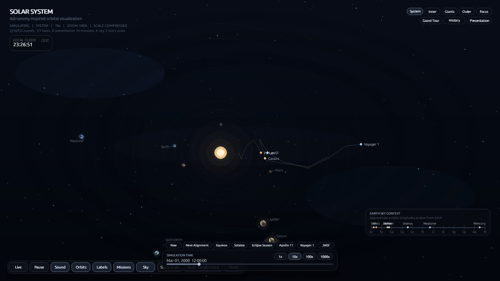
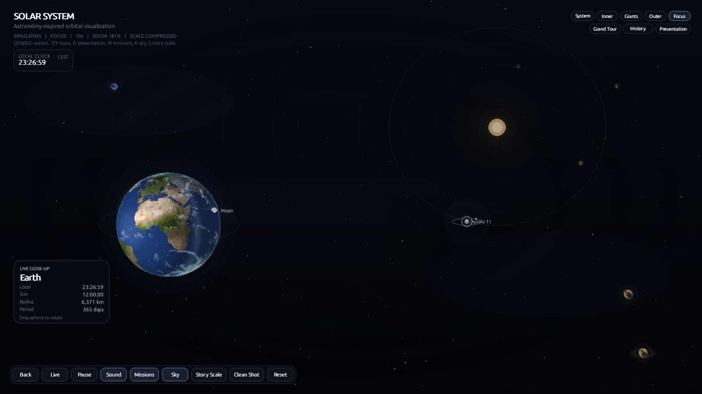
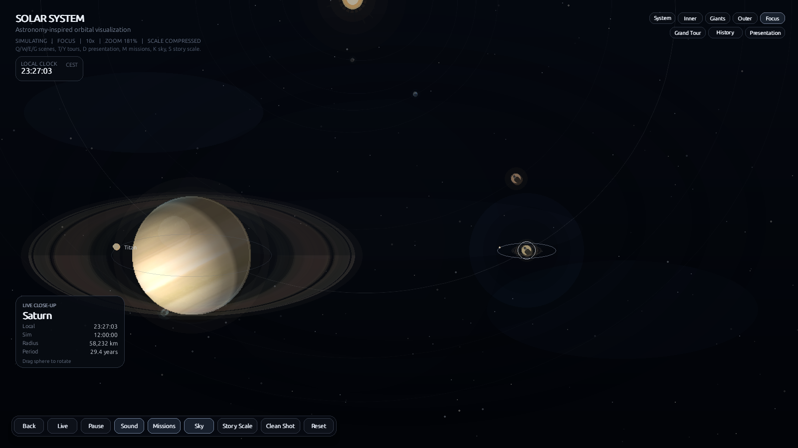

# Gravity Studio

A desktop viewer for the Solar System, written in Python with Pygame. It draws the Sun and the eight planets on elliptical orbits, lets you step through time between 1960 and 2165, and opens a textured, rotating close-up when you click a planet.



| Earth close-up | Saturn close-up |
| --- | --- |
|  |  |

The screenshots were rendered headless (SDL dummy driver) at 1600x900, so they are what the app draws, not mock-ups.

## What it does

- The Sun and 8 planets, with a compressed distance scale so the whole system fits on one screen. A second scale mode (`Scale` button, `S` for the story view) stretches distances toward the real ratios.
- Six major moons: the Moon, Io, Europa, Ganymede, Callisto and Titan.
- Five mission trajectories: Parker Solar Probe, JWST, Voyager 1, Cassini-Huygens and Apollo 11.
- A time slider from 1960-01-01 to 2165-01-01, speed presets (1x, 10x, 100x, 1000x), quick jumps to dates such as an equinox, a solstice or the Apollo 11 landing, and a `Live` mode that follows the real clock.
- Scene presets (System, Inner, Giants, Outer), a focus view per planet, and two scripted tours (Grand Tour, History).
- A strip showing approximate ecliptic longitudes of the planets as seen from Earth.
- Screenshots with `P`, or without the UI via `Clean Shot`.
- Settings (scene, scale mode, overlay toggles) are stored in `.gravity_studio/` in the working directory.

Limits worth knowing: orbits are simplified ellipses with inclination cues, not an ephemeris, so positions are illustrative and not suitable for navigation or observing plans. Mission paths are stylised polylines. Ambient audio is synthesised at start-up.

## Run it

You need Python 3.10 or newer and a desktop that can open a Pygame window. The app starts fullscreen.

```bash
python3 -m venv .venv
source .venv/bin/activate
pip install -r requirements.txt
python main.py
```

Other entry points: `python -m orbit_sim`, or `pip install -e .` followed by `gravity-studio`. The textures live in `assets/`, outside the Python package, so use an editable or source install; a built wheel contains only code. Without the textures the app falls back to flat discs.

### One-file desktop build

```bash
pip install pyinstaller
python scripts/build_desktop.py
```

This runs PyInstaller on `gravity_studio.spec` and bundles `assets/`. PyInstaller is not a project dependency, you install it yourself.

## Controls

| Action | Input |
| --- | --- |
| Select a planet | Left click |
| Rotate the focus sphere | Left drag on the focused planet |
| Zoom | Mouse wheel |
| Scenes: System, Inner, Outer, Giants | `Q` / `W` / `E` / `G` |
| Focus the selected planet | `F` |
| Grand Tour, History tour | `T` / `Y` |
| Presentation mode | `D` |
| Time speed 1x to 1000x | `1` to `4` |
| Pause or resume | `Space` |
| Orbit lines, labels | `O`, `L` |
| Missions, sky strip, story scale | `M`, `K`, `S` |
| Hide or show the UI | `H` |
| Screenshot | `P` |

Everything else (Live, Sound, Scale, Reset, Clean Shot, date chips and the timeline slider) is on screen.

## Development

```bash
pip install -r requirements.txt pytest ruff
ruff check .
SDL_VIDEODRIVER=dummy SDL_AUDIODRIVER=dummy pytest
```

There are 163 tests. They cover the orbit math, time and date jumps, the scale modes, settings loading, texture loading and the data tables for planets, moons and missions, and they run without a display. CI runs ruff and the tests on Python 3.10 to 3.13.

| Path | Purpose |
| --- | --- |
| `main.py`, `orbit_sim/__main__.py` | Entry points |
| `orbit_sim/app.py` | Main loop, input handling, state |
| `orbit_sim/simulation.py` | Orbital state and the simulation clock |
| `orbit_sim/solar_system.py`, `satellites.py`, `missions.py`, `tours.py` | Data tables |
| `orbit_sim/camera.py` | Layout, zoom, scene presets, distance scaling |
| `orbit_sim/rendering.py`, `planet_sphere.py`, `planet_textures.py` | Scene and textured sphere rendering |
| `orbit_sim/ui.py` | HUD and controls |
| `orbit_sim/settings.py` | Settings persistence |
| `assets/planets/` | Planet maps and the Saturn ring mask |
| `tests/` | pytest suite |

`web/` holds a separate browser version and is not described here.

## License

The source code is MIT, see [LICENSE](LICENSE). The planet textures in `assets/planets/` come from [Solar System Scope](https://www.solarsystemscope.com/textures/) and are CC BY 4.0, which is not the same licence as the code. Third-party components, including pygame (LGPL-2.1, imported as a library and not modified), are listed in [3rdparty_licenses.md](3rdparty_licenses.md).
